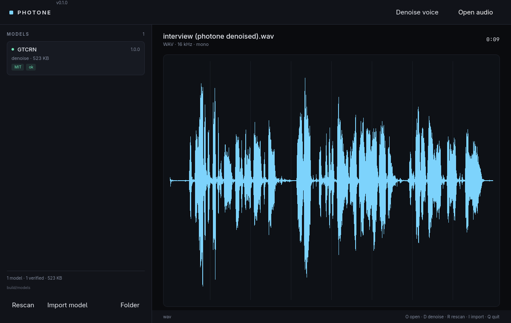

# Photone

Локальное приложение для разделения и очистки аудио: стемы из готового микса,
барабаны, голоса, денойзинг — всё на своей машине, без загрузок наружу.
Целевая платформа — macOS на Apple Silicon (M1, Sequoia); разработка идёт на Linux.



## Что работает

**M0 — оболочка и доверие к моделям:**

- Хранилище `~/Library/Application Support/photone/models/<id>/<version>/`
  (Linux: `~/.local/share/photone/models`).
- Ed25519-подпись покрывает `manifest.json` байт-в-байт, манифест пинит SHA-256
  каждого файла. Одна подпись аутентифицирует весь каталог.
- Статусы `ok / unverified / corrupt / incompatible / broken`; подмена байта в
  весах ловится хешем, подмена манифеста — подписью.
- Волна из `ffmpeg`, CLI без дисплея: `photone --scan [--json]`.

**M1 — первый настоящий звук:**

- ONNX Runtime в C++, драйвер `gtcrn` (16 кГц, STFT 512/256, sqrt-Hann, WOLA).
- Модель GTCRN: 523 КБ, 0.05M параметров, MIT включая веса.
- CLI: `photone --denoise <in> <out>`; в приложении — кнопка **Denoise voice**
  и клавиша `D`.

Замеры на этой машине (i5-3210M, 2 ядра / 4 потока, без GPU):

| Потоки | 9.77 с речи | Реальное время |
|---|---|---|
| 1 | 1.99 с | **4.9×** |
| 2 | 2.11 с | 4.6× |
| 4 | 3.61 с | 2.7× |

Больше потоков — медленнее: граф крошечный, синхронизация дороже вычислений.
Поэтому по умолчанию один поток.

Сверка реализаций: C++ против независимого Python-референса — SI-SNR 70 дБ,
максимальное расхождение 3·10⁻⁵ (это разница float32 против float64 в
накоплении), корреляция 1.000000. Python-референс против **авторского**
`enh.wav` — 77 дБ и 1.0000, то есть предобработка восстановлена верно, а не
подогнана.

## Сборка

Linux (разработка):

```bash
./scripts/dev-keys.sh                 # один раз: ключевая пара для подписи моделей
cmake -S . -B build -DCMAKE_BUILD_TYPE=RelWithDebInfo
cmake --build build -j
```

macOS (цель), после `brew install qt ffmpeg libsodium cmake pkg-config onnxruntime`:

```bash
cmake -S . -B build \
  -DCMAKE_PREFIX_PATH="$(brew --prefix qt)" \
  -DONNXRUNTIME_ROOT="$(brew --prefix onnxruntime)"
cmake --build build -j
open build/photone.app
```

ONNX Runtime необязателен при конфигурации: без него собирается всё, кроме
движка, а денойзинг честно сообщает, что движка нет.

## Модели

```bash
# GTCRN, 16 кГц денойзер речи (523 КБ)
curl -L -o gtcrn_simple.onnx \
  https://huggingface.co/bitsydarel/gtcrn-onnx/resolve/main/gtcrn_simple.onnx
./scripts/install-gtcrn.sh gtcrn_simple.onnx ~/.local/share/photone/models
```

```bash
./build/photone --denoise interview.wav clean.wav --root ~/.local/share/photone/models
./build/photone --scan --json
```

Формат манифеста — см. ниже; поле `driver` задаёт контракт рантайма
(`gtcrn` сейчас, `htdemucs` и `roformer` дальше), `engine_abi` — совместимость
с бинарём.

```json
{
  "schema": 1,
  "id": "denoise/gtcrn",
  "version": "1.0.0",
  "name": "GTCRN",
  "kind": "denoise",
  "driver": "gtcrn",
  "engine_abi": 1,
  "sample_rate": 16000,
  "channels": 1,
  "stems": ["voice"],
  "license": { "code": "MIT", "weights": "MIT", "commercial": true },
  "files": [
    { "path": "gtcrn_simple.onnx", "sha256": "...", "size": 535638 }
  ]
}
```

Подпись: `photone-sign sign <model-dir> <private-key>` создаёт `manifest.sig`.
Публичный ключ зашит в бинарь (`keys/dev.pub` → `cmake/pinned_key.h.in`),
приватный лежит в `.dev-keys/` и в git не попадает.

## Тесты

```bash
./scripts/test.sh        # 10 проверок: доверие, подмена, детерминизм денойзинга
cd build && ctest        # асинхронный путь через движок (Qt Test)
```

## Лицензии моделей

См. [docs/MODELS.md](docs/MODELS.md). Коротко: при личном использовании
ограничений нет, но `DrumSep 5-stem`, `BS-RoFormer` и `Spleeter` **не
декларируют лицензию весов** — их нельзя перераспространять, только скачивать
у авторов. MUSDB18, на котором обучено почти всё, сам некоммерческий
(`CC BY-NC-SA`).

## Дальше

M2 — реестр обновлений: скачивание моделей по HTTP-индексу, докачка, откат,
пиннинг версии в проекте. M3 — htdemucs и 4 стема. План и обоснования —
[docs/ARCHITECTURE.md](docs/ARCHITECTURE.md).
