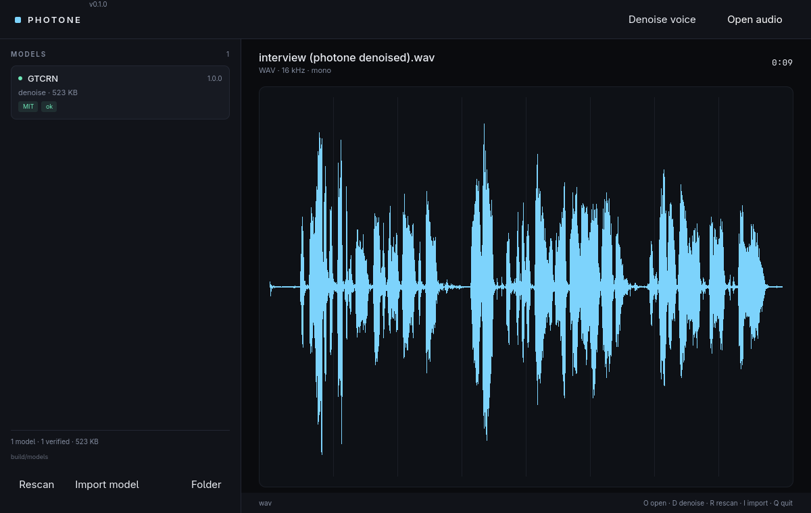

Локальное разделение и очистка аудио: стемы, денойзинг, микшер, пакетная обработка. Вес — ноль облака.



## Что умеет

- **Четыре стема** из готового микса (htdemucs, ONNX): drums / bass / other / vocals.
- **Очистка речи** (GTCRN): денойзинг, 16 кГц, работает в 21× реального времени на Apple M1 и в 5× на i5-3210M.
- **Микшер стемов**: mute, solo, гейн, воспроизведение с перемоткой, экспорт микса.
- **Пакетная обработка**: очередь файлов, модель загружается один раз, ошибка одного файла не останавливает остальные.
- **Экспорт**: открытый файл — результат денойзинга, стем или микс — сохраняется в WAV/FLAC/MP3.
- **Хранилище моделей с подписями**: Ed25519 над манифестом, SHA-256 весов, версии, пиннинг, откат.
- **Обновление моделей** по HTTP-индексу без переустановки приложения.

## Linux (x86_64)

```bash
tar xzf stemhand-*-linux-x86_64.tar.gz
cd stemhand-*-linux-x86_64
./run.sh --version
./run.sh --scan
./run.sh                # GUI
```

Внутри уже лежит `libonnxruntime.so` — системный ONNX Runtime не нужен. Нужен
`ffmpeg` в `PATH` (декодирование и экспорт); на macOS то же самое, библиотека
ONNX Runtime лежит внутри бандла.

```bash
./run.sh --batch denoise out/ *.wav
./run.sh --separate song.mp3 stems/
```

## macOS (Apple Silicon)

```bash
sudo installer -pkg stemhand-*-macos-arm64.pkg -target /
open /Applications/stemhand.app
```

Или двойным кликом по `.pkg`. Подпись ad-hoc: пакет не нотаризован, поэтому
Gatekeeper может отказать — тогда правый клик → Open, либо
`xattr -dr com.apple.quarantine stemhand-*.pkg` и снова открыть.

Собрать самому тоже можно:

```bash
brew install qt onnxruntime libsodium ffmpeg pkg-config cmake
git clone https://github.com/ltillegal/stemhand && cd stemhand
./scripts/build-macos.sh
open build-macos/stemhand.app
```

## Модели

Весов в репозитории нет, они ставятся отдельно и проверяются по подписи:

```bash
curl -L -o build/downloads/gtcrn_simple.onnx \
  https://huggingface.co/bitsydarel/gtcrn-onnx/resolve/main/gtcrn_simple.onnx
./scripts/install-gtcrn.sh build/downloads/gtcrn_simple.onnx

curl -L -o build/downloads/htdemucs.onnx \
  https://huggingface.co/MrCitron/demucs-v4-onnx/resolve/main/htdemucs.onnx
./scripts/install-demucs.sh build/downloads/htdemucs.onnx
```

## Проверено

27 shell-проверок и 10 Qt-тестов: подписи и подмена весов, детерминизм,
отмена, воспроизведение, пакетная обработка, экспорт, обновления и откат.

---

Local stem separation and voice cleanup: four stems, speech denoising, a stem
mixer and a batch queue — all on your machine. The Linux tarball bundles ONNX
Runtime; macOS builds from source with `./scripts/build-macos.sh`. Model weights
are downloaded separately and verified against a signed manifest.
